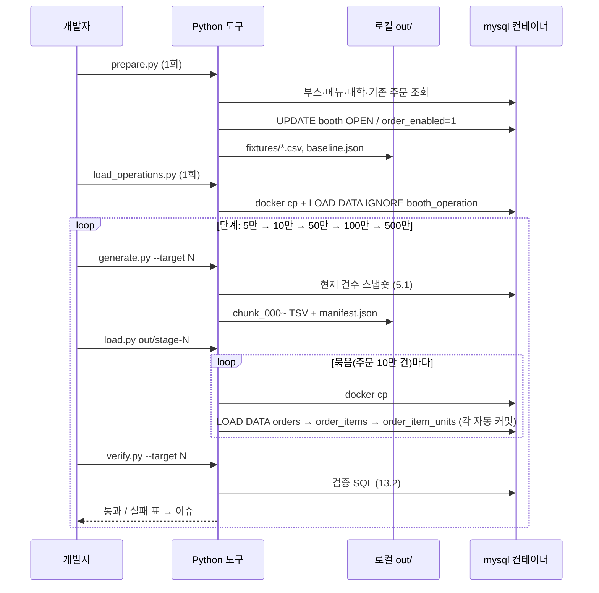

# LLD-0006: 핫스팟 분포 주문 대량 적재 (Python 생성기 → CSV → LOAD DATA, 누적 5만→500만)

| 항목 | 내용 |
|---|---|
| 상태 | 확정 |
| 작성일 | 2026-10-12 |
| 관련 이슈 | [#18](https://github.com/silversieon/likelion14th-festival-be-V2/issues/18) (상위: #6) |
| 관련 ADR | [ADR-0004](../adr/ADR-0004-order-bulk-load-with-csv-load-data.md) — 옵션 3 승인 (2026-10-12), FK 켠 채로 적재 |
| 대상 도메인 | order (`orders`, `order_items`, `order_item_units`) · booth (`booth`, `booth_operation`) |
| 작업 갈래 | ② 대량 데이터 삽입 (AGENTS.md 1.4) |
| 관련 방침 | `docs/policy/development-policy.md` 3.1 · 3.2 · 3.3 · 3.4, 18.3 |
| API 스펙 | 해당 없음 |
| 스키마 변경 | 없음 (행 추가 + `booth.booth_status`·`order_enabled` 값 변경) |

## 1. 개요 및 범위

사용자가 지정한 **학교·부스·메뉴 3단계 핫스팟 분포**대로 주문을 만들어, 누적 5만 → 10만 → 50만 → 100만 → 500만 건까지 단계적으로 적재한다. 이후 성능 작업(작업 갈래 ③)의 측정 기반 데이터다.

ADR-0004에 따라 **Python 생성기가 분포대로 행을 만들어 CSV(정확히는 탭 구분 TSV)로 쓰고**, MySQL 컨테이너의 `secure_file_priv` 폴더(`/var/lib/mysql-files`, MySQL이 서버 쪽 파일 읽기를 허용하는 유일한 폴더)에 복사한 뒤 `LOAD DATA INFILE`로 넣는다.

**기존 방식과의 차이**: ADR-0002·0003(부스·메뉴·매니저)은 Flyway SQL 한 문장(`INSERT ... SELECT`)으로 DB 안에서 데이터를 만들었다. 이번에는 분포 규칙이 복잡해 **DB 밖(Python)에서 행을 만들고 파일로 넣는다.**

### 범위

| 포함 | 제외 (Out of Scope) |
|---|---|
| 사전 준비 — 모든 부스 `OPEN` + `order_enabled = 1`, 고정 목록(fixture) 생성 | 단계별 쿼리 성능 측정 (개발자가 직접 또는 별도로 진행 — ADR-0004 개발자 응답) |
| 학교별 축제 일정 `booth_operation` 적재 (1회) | 주문 생성 API 부하 테스트용 "당일 운영 일정" 스크립트 |
| 주문 3개 테이블 단계 적재 (5회) | `idempotency`·`outbox` 행 (policy 3.4) |
| 단계별 검증·롤백 도구 | 운영 코드(`src/main`) 변경 |

### 현재 상태 (Before)

2026-10-12 로컬 DB(`festival2`) 실측:

| 항목 | 값 |
|---|---|
| 대학 / 부스 | 359 / 14,093 (서경대 31) |
| 주문 / 항목 / 단위 | 2,284 / 최대 id 4,330 / 최대 id 5,310 — **전부 서경대(university_id = 1)** |
| 주문 id 범위 | 545 ~ 2,828 |
| 주문당 메뉴 수 (기존) | 0개 14 · 1개 1,212 · 2개 772 · 3개 226 · 4개 48 · 5개 5 · 6개 6 · 7개 1 |
| 상태 (기존) | WAITING 12 · COOKING 268 · COMPLETED 1,911 · CANCELED 93 |
| 기존 주문 상위 부스 | 23(287건) · 11(270) · 18(266) · 7(242) · 25(240) … |
| `booth_operation` | 296(최대 id), 서경대 부스만 존재 (5/13 30행 · 5/14 31행 · 5/15 29행 + 테스트 행) |
| MySQL | 8.0.46, 버퍼 풀 1,280MB(인스턴스 1), `secure_file_priv=/var/lib/mysql-files/`, `local_infile=0` |

## 2. 데이터 모델 (엔티티 / 테이블)

### 2.1 대상 엔티티

| 엔티티 | 테이블 | 신규/변경 | 위치 |
|---|---|---|---|
| Order | `orders` | 행 추가 | `domain/order/entity/Order.java` |
| OrderItem | `order_items` | 행 추가 | `domain/order/entity/OrderItem.java` |
| OrderItemUnit | `order_item_units` | 행 추가 | `domain/order/entity/OrderItemUnit.java` |
| BoothOperation | `booth_operation` | 행 추가 (축제 일정) | `domain/booth/entity/BoothOperation.java` |
| Booth | `booth` | 값 변경 (`booth_status`, `order_enabled`) | `domain/booth/entity/Booth.java` |

### 2.2 필드 / 컬럼 정의 (적재 파일의 열 순서 = 아래 순서)

**`orders`**

| 컬럼 | 값 규칙 |
|---|---|
| `id` | 생성기가 배정 (현재 `MAX(id)+1`부터 연속) |
| `table_number` | 1~30 균등 |
| `num_of_people` | 1~6 균등 |
| `customer_name` | 이름 풀 500개(성 20 × 이름 25, 6.4절) 균등 |
| `customer_phone_number` | `010-XXXX-XXXX`, 각 4자리 0000~9999 균등 |
| `total_order_price` | 그 주문 `order_items.total_order_item_price`의 합 |
| `completed_at` | 상태 규칙 (2.3) |
| `canceled_at` | 상태 규칙 |
| `order_status` | `WAITING` \| `COOKING` \| `COMPLETED` \| `CANCELED` |
| `order_cancel_reason` | CANCELED만: `ORDER_MISTAKE` \| `ETC` \| `OUT_OF_STOCK` \| `CUSTOMER_REQUEST` 균등, 나머지 `\N`(NULL) |
| `created_at` | 시각 규칙 (6.3) |
| `modified_at` | 상태 규칙 |

**`order_items`**: `id`, `quantity`, `menu_price`(= fixture에 고정한 메뉴 가격), `total_order_item_price`(= quantity × menu_price), `order_id`, `booth_menu_id`

**`order_item_units`**: `id`, `is_served`(0/1), `order_item_id` — 항목마다 `quantity`개

**`booth_operation`**: `id`, `booth_id`, `operation_date`, `time_type`=`ALL`, `day_open_time`=`00:00:00`, `night_open_time`=`\N`, `close_time`=`23:59:00`, `created_at`, `modified_at`(적재 시각)

> 하루 종일 운영(개발자 지시). `night_open_time`을 NULL로 두면 `getCurrentOrderTimeType`이 하루 종일 `DAY`로 판단한다 — CSV 적재에는 영향이 없고, 부스 상세 화면에 "하루 종일 운영"으로 보인다.

### 2.3 비즈니스 규칙 / 불변식 (생성기가 지켜야 하는 것)

- **주문 1건 = 부스 1곳**: 한 주문의 모든 항목은 같은 부스의 메뉴다
- **주문 안 메뉴 중복 금지**: 같은 메뉴는 한 주문에 한 항목만, 여러 개는 수량으로
- **가격 정합성**: `menu_price` = 메뉴 가격, `total_order_item_price` = 수량 × 가격, `total_order_price` = 항목 합계의 합
- **단위 수 = 수량**: 항목마다 `order_item_units`가 정확히 `quantity`행
- **상태별 컬럼** (`Order.changeOrderStatus`·`cancelOrder`의 전이 결과와 같게):

| 상태 | `completed_at` | `canceled_at` / 사유 | `is_served` | `modified_at` |
|---|---|---|---|---|
| WAITING | NULL | NULL / NULL | 전부 0 | `created_at` |
| COOKING | NULL | NULL / NULL | 단위 n개 중 0~(n−1)개 균등 무작위로 1 → 최소 1개는 0 | `created_at` + 1~15분 균등 |
| COMPLETED | `created_at` + 5~40분 균등 | NULL / NULL | 전부 1 | `completed_at` |
| CANCELED | NULL | `created_at` + 1~30분 균등 / 4종 균등 | 전부 0 | `canceled_at` |

- **주문 대상 제외**: 품절(`is_sold_out = 1`) 메뉴, 0원 메뉴, 주문 가능 메뉴가 2개 미만인 부스, **주문 가능 메뉴가 정확히 2개인 부스**(모든 메뉴가 대표 메뉴가 되어 65% 조건을 만족할 수 없음 — 14장 Q3, 현재 서경대 부스 1 · 12 · 35). 이 부스들의 기존 주문은 그대로 둔다

### 2.4 이벤트

해당 없음 — 앱을 거치지 않고 DB에 직접 넣으므로 SSE·아웃박스 이벤트가 발생하지 않는다 (의도된 동작, policy 3.4).

## 3. 클래스 / 시그니처 정의

운영 코드 변경 없음. 도구 코드만 추가한다 (`src/` 밖 — Gradle·spotless 대상 아님). **Python 3.11 이상, 표준 라이브러리만** 쓴다. DB 접근은 드라이버 없이 `docker exec mysql mysql ...`을 `subprocess`로 호출한다 (Windows 셸 경로 변환 문제를 피하려고 셸 스크립트 대신 Python에서 직접 호출).

```python
# scripts/seed/order/common.py — 공통
MYSQL_CONTAINER = "mysql"; DB = "festival2"; IN_CONTAINER_DIR = "/var/lib/mysql-files/order-seed"
def query(sql: str) -> list[list[str]]            # docker exec ... mysql -B -N -e  → 탭 분리 행
def execute(sql: str) -> float                    # 실행 + 소요 초 반환, 실패 시 예외
def docker_cp(local_path: Path, container_path: str) -> None
def largest_remainder(total: int, weights: list[float]) -> list[int]   # 6.1
def water_fill(required: int, targets: list[int], current: list[int]) -> list[int]  # 6.2

# scripts/seed/order/prepare.py — [0] 사전 준비 (1회)
#   사용: python prepare.py [--seed 20261012]
#   1) UPDATE booth SET booth_status='OPEN', order_enabled=1
#   2) fixtures/*.csv 생성 (이미 있으면 덮어쓰지 않고 종료 코드 1 — --force로만 재생성)
def build_groups() -> dict[int, str]                      # university_id → HOT|WARM|ETC
def build_menus() -> dict[int, list[Menu]]                 # booth_id → 주문 가능 메뉴(가격 고정)
def build_rep_menus(menus) -> dict[int, tuple[int, int]]  # booth_id → 대표 메뉴 2개 (6.4)
def build_popular_booths(menus) -> dict[int, list[int]]    # Hot university_id → 인기 부스 3개
def build_festival_dates(groups, rng) -> dict[int, list[date]]  # university_id → 3일 (6.3)

# scripts/seed/order/load_operations.py — [1] 축제 일정 적재 (1회)
#   사용: python load_operations.py
def write_operations_tsv(out: Path) -> int                # 모든 부스 × 그 학교 3일
#   LOAD DATA ... IGNORE INTO TABLE booth_operation  (UNIQUE(booth_id, operation_date) 중복은 건너뜀 → 서경대 기존 행 보존)

# scripts/seed/order/generate.py — [2] 단계 생성
#   사용: python generate.py --target 50000 [--seed 20261012] [--chunk 100000] [--out out/stage-050000]
@dataclass
class Snapshot:                       # 생성 시점 DB 현황 (5.1)
    total_orders: int
    orders_by_booth: dict[int, int]
    status_counts: dict[str, int]
    k_counts: dict[int, int]          # 주문당 메뉴 수별 주문 수 (0, 5 이상 포함)
    rep_qty_by_booth: dict[int, int]  # 대표 메뉴 판매 수량
    qty_by_booth: dict[int, int]      # 전체 판매 수량
    max_ids: dict[str, int]           # orders / order_items / order_item_units
def read_snapshot() -> Snapshot
def plan_booth_quotas(target: int, snap: Snapshot, fx: Fixtures) -> dict[int, int]   # 6.2
def plan_status_quotas(target: int, snap: Snapshot) -> dict[str, int]                # 6.5
def plan_k_quotas(target: int, snap: Snapshot) -> dict[int, int]                     # 6.5
def rep_probability(booth_id: int, new_orders: int, snap: Snapshot) -> float         # 6.4
def generate(target: int, seed: int, chunk: int, out: Path) -> Manifest             # TSV + manifest.json

# scripts/seed/order/load.py — [3] 단계 적재
#   사용: python load.py out/stage-050000
def load_stage(stage_dir: Path) -> None   # 묶음마다 cp → LOAD orders → items → units → 컨테이너 파일 삭제, 소요 기록

# scripts/seed/order/verify.py — [4] 검증
#   사용: python verify.py --target 50000      → 표 출력, 하나라도 실패면 종료 코드 1
# scripts/seed/order/rollback.py — 단계 롤백
#   사용: python rollback.py out/stage-050000  → manifest의 id 구간을 자식부터 5만 행씩 DELETE
```

## 4. 패키지 / 클래스 구조

```
scripts/seed/order/
├── README.md              # 실행 순서·명령·주의사항
├── common.py
├── prepare.py             # [0] 사전 준비 + fixture 생성
├── load_operations.py     # [1] 축제 일정
├── generate.py            # [2] 단계 생성
├── load.py                # [3] 단계 적재
├── verify.py              # [4] 검증 (자동 판정)
├── verify-queries.sql     # 조건별 수동 확인 SQL (사람이 표로 확인·발표 자료용)
├── rollback.py            # 단계 롤백
├── fixtures/              # 커밋한다 — 재현성의 기준
│   ├── groups.csv             # university_id, group
│   ├── booths.csv             # booth_id, university_id (모든 부스)
│   ├── menus.csv              # booth_id, menu_id, price, is_rep
│   ├── popular_booths.csv     # university_id, booth_id
│   ├── festival_dates.csv     # university_id, day1, day2, day3
│   └── baseline.json          # 적재 전 기준값 (기존 주문 id 상한·건수·합계, idempotency·outbox 건수)
└── out/                   # .gitignore — 단계별 TSV + manifest.json (500만 단계는 수 GB)
```

## 5. 시퀀스 흐름



### 5.1 스냅숏 쿼리 (매 단계 생성 직전)

```sql
-- 부스별 기존 주문 수 (주문 1건 = 부스 1곳이 보장된 상태)
SELECT bm.booth_id, COUNT(DISTINCT oi.order_id)
FROM order_items oi JOIN booth_menu bm ON bm.id = oi.booth_menu_id
GROUP BY bm.booth_id;

-- 주문당 메뉴 수 분포 (항목 없는 주문 = 0)
SELECT k, COUNT(*) FROM (
  SELECT o.id, COUNT(oi.id) k FROM orders o LEFT JOIN order_items oi ON oi.order_id = o.id GROUP BY o.id
) t GROUP BY k;

-- 부스별 대표 메뉴 수량 / 전체 수량 (대표 메뉴 목록은 fixtures/menus.csv의 is_rep)
SELECT bm.booth_id, SUM(oi.quantity) FROM order_items oi JOIN booth_menu bm ON bm.id = oi.booth_menu_id GROUP BY bm.booth_id;
```

## 6. API 명세

해당 없음.

### 6.1 쿼터 배분 — 최대 잉여 방식

정수 건수를 비율대로 나눌 때 `round()`를 각각 하면 합이 맞지 않는다. **최대 잉여 방식**(각 몫을 내림한 뒤, 남은 건수를 소수점 아래가 큰 순서로 1씩 더 주는 방식)으로 나눠 **합계를 정확히 맞춘다.** 동점은 id가 작은 쪽이 먼저.

### 6.2 학교·부스 배분 — 목표 누적 기준 + 물 채우기

1. **그룹 목표** (누적 N 기준): HOT 50% · WARM 35% · ETC 15% → 최대 잉여 방식
2. **학교 목표**: HOT 5개교 균등(각 10%), WARM 48개교 균등, ETC 306개교 균등
3. **부스 목표**:
   - HOT: 인기 부스 3곳에 학교 목표의 70%를 **균등**, 나머지 주문 가능 부스에 30%를 **균등** (14장 Q1)
   - WARM·ETC: 학교 안 주문 가능 부스에 균등
4. **이번 단계 생성량** = 셀마다 목표 − 현재. 기존 서경대 주문처럼 **이미 목표를 넘은 부스가 있으면** 그 셀은 0으로 두고, 같은 상위 셀(학교의 "인기"/"나머지" 묶음)의 남은 몫을 **부족분이 큰 부스부터 채운다**(물 채우기, water-filling — 가장 낮은 곳부터 물을 채우듯 목표 대비 부족분이 큰 부스에 먼저 배정). 단계가 커질수록 기존 편차는 비율상 사라진다.
   - **하위 칸의 목표는 "단계가 끝났을 때 상위 칸이 갖게 될 건수(현재 + 이번 배정)"를 균등 분할한 값**으로 잡는다 (구현 중 수정). 처음에는 상위 칸의 *목표*를 나눴는데, 항목 없는 기존 주문 14건을 ETC에서 차감하면서 ETC 학교 간 편차가 2(23~25건)로 벌어졌다
5. **항목 없는 기존 주문 14건**은 어느 부스에도 속하지 않으므로 ETC 그룹 생성량에서 차감해 누적 합계를 N에 맞춘다.

서경대 1단계 실현 가능성 확인: 서경대 목표 5,000 = 인기 3,500 + 나머지 1,500. 기존 인기 부스(23·11·18) 823건, 나머지 부스 1,447건(항목 없는 14건 제외, 신규 대상에서 빠진 부스 1·12·35의 기존 주문 포함) → 나머지 몫 1,500 이내로 **1단계부터 70/30을 맞출 수 있다.**

### 6.3 시각 — 학교별 축제 3일

- **축제 기간 창**: 연속 평일 3일. 2026년 5월 2주(5/11)~6월 1주(6/5) 중 **공휴일을 포함하지 않는 창**만 쓴다 (14장 Q2)
  - 사용 창 8개: 5/11–13 · 5/12–14 · 5/13–15 · 5/18–20 · 5/19–21 · 5/20–22 · 5/26–28 · 5/27–29
  - 제외: 5/25(부처님오신날 대체공휴일)을 포함하는 창, 6/3(전국동시지방선거일)을 포함하는 6월 1주 창 전부
- **배정**: 서경대 5/13–15 고정. 나머지 358개교는 `university_id` 순서를 시드로 섞은 뒤 8개 창에 차례로 돌려 배정 → 창마다 약 45개교
- **날짜 비중**: 1일차 20% · 2일차 42% · 3일차 38% (서경대 실측)
- **시간대 비중** (서경대 5/13–15 실측 2,284건, 단위 %):

| 시 | 10 | 11 | 12 | 13 | 14 | 15 | 16 | 17 | 18 | 19 | 20 | 21 | 22 | 23 |
|---|---|---|---|---|---|---|---|---|---|---|---|---|---|---|
| % | 0.1 | 0.8 | 1.3 | 0.4 | 1.7 | 0.8 | 2.0 | 7.8 | 31.6 | 25.7 | 17.5 | 6.0 | 3.9 | 0.5 |

- 시 안에서 분·초·마이크로초는 균등. 운영 시간이 하루 종일이므로 시간대 비중을 그대로 쓴다
- 상태 시각(`completed_at` 등)이 자정을 넘어가도 그대로 둔다

### 6.4 메뉴 — 대표 메뉴 판매 수량 65%

- **대표 메뉴 2개 (고정)**:
  - 서경대 부스: 기존 판매 수량 상위 2개 (동점은 id 작은 쪽), 주문 가능 메뉴 중에서
  - 그 외 부스: 주문 가능 메뉴 중 id가 가장 작은 2개
- **인기 부스 3곳 (고정)**: 서경대 23 · 11 · 18 (기존 주문 상위) / 광운대(46) 2217 · 2218 · 2219 / 덕성여대(103) 4728 · 4729 · 4730 / 성신여대(172) 7736 · 7737 · 7738 / 한성대(343) 13450 · 13451 · 13452 (각 학교 주문 가능 부스 중 id 작은 3개)
- **주문마다 메뉴 고르기** (메뉴 수 k는 6.5에서 정해진다):
  1. 대표 메뉴 개수 r = min(k, 2) 를 확률 q_b로, r = min(k, 2) − 1 을 확률 1 − q_b로 정한다
  2. 대표 메뉴 r개 + 나머지 메뉴에서 중복 없이 k − r개를 균등 선택
  3. 항목마다 수량을 6.5의 분포로 뽑는다
- **감소 주문 수 계산** (구현 중 수정 — 확률 q_b 대신 정확한 건수): 수량이 메뉴와 무관하게 같은 분포이므로 판매 수량 비율 ≈ 항목 수 비율이다. 부스 b에서 "기존 대표 수량 + 신규 대표 항목 수 × 평균 수량 = 0.65 × (기존 전체 수량 + 신규 항목 수 × 평균 수량)"이 되도록 **대표 메뉴를 하나 덜 넣을 주문 수**를 정하고, 그 수만큼을 부스 안에서 비복원 추출(남은 감소 수 ÷ 남은 주문 수 확률)로 고른다 → 부스별 건수가 정확하다
  - **기존 주문이 있는 부스(서경대)**: 부스마다 위 식을 반올림해 [0, 줄일 수 있는 주문 수]로 자른다
  - **기존 주문이 없는 부스**: 부스마다 반올림하면 주문 1~2건짜리 부스(ETC 대부분)에서 손실이 쌓인다(1단계 첫 실행에서 서경대 외 64.35%). **전체 감소 수를 먼저 정하고** 부스별 원하는 감소 수에 비례해 최대 잉여 방식으로 나눈다 → 서경대 외 합산 64.97%
  - 부작용: 메뉴 4개짜리 주문 하나뿐인 부스처럼 65%에 닿을 수 없는 작은 부스의 몫을 큰 부스가 메우므로, 1단계에서 HOT 인기 부스(서경대 제외)는 65.3~66.3%로 약간 높다. 단계가 커지면 작은 부스도 주문이 늘어 줄어든다
- **상한**: 메뉴 수 분포가 10/25/50/15%면 대표 메뉴 항목 비율의 이론 최대는 E[min(k,2)] / E[k] = 1.9 / 2.7 = **70.4%**다. 65%는 이 안에 있지만 여유가 크지 않다
- **예외 부스**: 주문 가능 메뉴가 정확히 2개인 부스(서경대 1 · 12 · 35)는 모든 메뉴가 대표 메뉴라 65%를 만들 수 없으므로 **신규 주문 대상에서 제외한다** (14장 Q3 → ②). 기존 주문은 서경대 "나머지 부스" 묶음의 현재 건수로 그대로 센다

### 6.5 상태·메뉴 수·수량

- **상태** (전체 주문 기준 누적): WAITING 5% · COOKING 10% · COMPLETED 75% · CANCELED 10% → 목표 − 현재를 생성
- **주문당 메뉴 수** (전체 주문 기준 누적): 1개 10% · 2개 25% · 3개 50% · 4개 15% → 목표 − 현재를 생성. 기존 주문 중 0개(14)·5개 이상(12) 26건은 **3개 목표에서 차감**해 합계를 N에 맞춘다
- 상태 목록과 메뉴 수 목록을 각각 정확한 건수로 만들고 시드로 섞어 주문에 짝짓는다. 부스의 주문 가능 메뉴 수보다 큰 k가 걸리면 같은 단계에서 **k가 작은 다른 주문과 맞바꾼다** (전체 건수는 유지 — 대상은 서경대 메뉴 3개 부스 3 · 6 · 8뿐)
- **항목당 수량** (서경대 축제 기간 실측, 재측정값): 1개 93.04% · 2개 5.68% · 3개 0.89% · 4개 0.32% · 5개 0.03% · 10개 0.03% — 항목마다 독립 추출

### 6.6 고객 정보

- 이름: 성 20개 × 이름 25개 = 500개 풀 (생성기 상수로 고정, 실존 인물 특정 불가한 흔한 조합)
- 전화번호: `010-` + 4자리 + `-` + 4자리 균등 무작위 → 사실상 중복 없음. 키워드 검색은 이름이 자주 걸리고 전화번호는 거의 안 걸리는 분포가 된다

## 7. 영속성 / 스키마 변경

### 7.1 마이그레이션

해당 없음 — 스키마 변경 없음. Flyway를 쓰지 않는다 (ADR-0004).

### 7.2 적재 / 롤백

**적재 문장** (묶음마다, 각 문장 자동 커밋, **FK 검사 켬** — ADR-0004):

```sql
LOAD DATA INFILE '/var/lib/mysql-files/order-seed/orders_000.tsv'
INTO TABLE orders CHARACTER SET utf8mb4
FIELDS TERMINATED BY '\t' ESCAPED BY '\\' LINES TERMINATED BY '\n'
(id, table_number, num_of_people, customer_name, customer_phone_number, total_order_price,
 completed_at, canceled_at, order_status, order_cancel_reason, created_at, modified_at);

LOAD DATA INFILE '/var/lib/mysql-files/order-seed/order_items_000.tsv'
INTO TABLE order_items FIELDS TERMINATED BY '\t' LINES TERMINATED BY '\n'
(id, quantity, menu_price, total_order_item_price, order_id, booth_menu_id);

LOAD DATA INFILE '/var/lib/mysql-files/order-seed/order_item_units_000.tsv'
INTO TABLE order_item_units FIELDS TERMINATED BY '\t' LINES TERMINATED BY '\n'
(id, is_served, order_item_id);
```

- 파일 규칙: UTF-8(BOM 없음), 탭 구분, 줄바꿈 `\n`, NULL은 `\N`, 시각은 `YYYY-MM-DD HH:MM:SS.ffffff`, 불리언 0/1
- **묶음 크기**: 주문 10만 건(≈ 항목 27만, 단위 29만) = 파일 3개 = 문장 3개. "전부 한 트랜잭션" 금지(policy 3.3)를 이 단위로 지킨다
- **실패 시**: `load.py`는 실패한 묶음에서 멈추고 묶음 번호를 출력한다. 그 묶음의 id 구간(manifest)을 `rollback.py --chunk`로 지운 뒤 `load.py --from-chunk`로 이어서 넣는다
- **단계 롤백**: manifest의 id 구간을 `order_item_units` → `order_items` → `orders` 순으로 **5만 행씩** `DELETE ... WHERE id BETWEEN ? AND ?`. CASCADE에 맡기지 않는다 — 한 문장이 수백만 행을 잠그기 때문 (ADR-0004)
- 롤백은 **가장 최근 단계부터** 한다 (다음 단계는 앞 단계 건수를 전제로 쿼터를 계산했다)

### 7.3 ERD 갱신

해당 없음 — 스키마 변경 없음.

## 8. 인덱스 / 쿼리 설계

해당 없음 — 인덱스를 추가·변경하지 않는다 (ADR-0004 "보조 인덱스는 그대로"). 적재 후 쿼리 측정은 이번 범위가 아니다.

## 9. 데이터 생성 스펙

### 9.1 사용자 지정 조건 (원문 인용)

> "주문 기준 대용량 데이터를 삽입하려고해. 그런데 그냥 데이터를 많이 넣는게 아니라 특정 조건을 기준으로 넣으려고해. 조건이 좀 어긋났거나, 아니면 추가 조건이 필요하면 프로젝트 내용을 파악하고 알려줄래? 우선 학교 핫스팟이야. 모든 학교에 주문을 골고루 분포시키는게 아니라 Hot 그룹 5개교 50%, Warm 그룹 50개교 35% 기타 15%로 할 것이며, Hot School 5개교 하위 부스 중 인기 부스 3개가 해당 학교 주문의 70%, 그 외 부스가 30%를 맡으면 좋겠어. 메뉴에도 핫스팟이 있어. 모든 Booth 의 대표 메뉴 (2개)가 해당 부스의 주문 65%를 차지하고, 나머지가 35%를 차지해야해. 주문의 상태도 비중이 나뉘어. 대기중 5%, 조리 중 10% 완료된 75% 취소 된 10%여야하며, 주문 하나가 가지는 메뉴 개수는 1~4개 정도로 분포해야해. 조건이 까다로운데 더 추가해야할 조건이 있는지 파악해주고, 이러한 조건을 맞춰서 데이터를 넣으려면 어떤 방법을 써서 넣어야하는지도 얘기해줘. 대용량 데이터는 한 번 넣을게 아니라 계속 조건에 부합하게 (주문 기준) 5만 건, 10만 건, 50만 건, 100만 건, 500만 건 이렇게 늘려서 넣을 거야."

> "1번은 (b)로 가고, 2번은 메뉴가 2개 미만인 부스는 주문 프로세스에서 제외할 거야. 대표 메뉴 2개는 임의 식별자를 정해서 고정만 하면 돼. Hot 학교는 서경대, 성신여대, 한성대, 덕성여대, 광운대로 할 것이며 warm은 이를 제외한 서울학교들.만약 50개가 조금 넘어도 이를 제외한 서울 학교들은 warm으로. 4번 질문은 이해가 안 가. 5번은 취소 사유는 아무거나 상관없고, is_served는 너가정한대로, 나머지는 그대로 가줘. 주문 1곳은 부스 1곳 맞고, 메뉴 개수 1이 10% 2가 25% 3이 50% 4가 15%로 해줘. 주문 안 메뉴 중복은 금지이며, 주문 시각 분포는 데이터를 통해 확인해줘. 학교별 축제 날짜는 별도로 추가해야하는데 이건 신경써서 방법 추천해주고, 부스는 전부 OPEN 에 order_enabled=1로 해둘 거야. 그냥 전부 연다고 가정. 단계 누적 방식이며 기존 서경대 데이터는 남겨야해."

> "1번 둘 다 균등 분배해주고, 2번은 그렇게 해줘. 3번은 재측정 다시하고 그거대로 해줘. 고객 이름 전화번호 4번은 그렇게 해주고, 메뉴 제외는 그렇게 해줘. 테이블 번호와 인원수도 그렇게 해주고 축제 날짜 방식은 고려가 필요한게 이게 날짜가 있어야 주문이 돼서, 내가 부하를 넣는 날에는 모든 부스에 날짜가 필요하거든? 그게 가능하도록 만들 수 있나?"

> "운영 시간은 하루종일, 3번의 부하라는 건 대용량 데이터 삽입을 얘기하는 것. 근데 CSV로 넣으면 Operation 필요없으려나? 생각해보니 그렇네. 처음 제안한 내용 다시 끌어오고, 최종적으로 내가 또 판단해야할 것 얘기해줘."

> "1번 A, 2번 분산에 맡김 3번 하루종일, 4번 끄고 적재 후 키기, 5번 Python, 6번 구간삭제 좋음 7번 사전 준비에서 하겠음."

> "옵션 3으로 해주고 FK 켜고해 그냥. 2번은 그렇게 scripts/seed/order/로 해주고 단계마다 쿼리 측정은 내가 하거나 별도로 할 거니까 빼."

(위 답변의 번호가 가리키는 질문과 확정 내용은 ADR-0004 컨텍스트 "확정된 세부 조건" 표에 정리되어 있다. "4번 끄고 적재 후 키기"는 이후 "FK 켜고해 그냥"으로 바뀌었다.)

### 9.2 적재 스펙

**단계별 누적 목표** (주문당 메뉴 수 기댓값 2.70, 항목당 수량 기댓값 1.088 — policy 3.2 행 증폭):

| 단계 | `orders` 누적 | 이번 단계 생성 | `order_items` 누적(약) | `order_item_units` 누적(약) | 묶음 수 |
|---|---|---|---|---|---|
| 1 | 50,000 | 47,716 (= 50,000 − 2,284) | 13.4만 | 14.6만 | 1 |
| 2 | 100,000 | 50,000 | 26.9만 | 29.3만 | 1 |
| 3 | 500,000 | 400,000 | 135만 | 147만 | 4 |
| 4 | 1,000,000 | 500,000 | 270만 | 294만 | 5 |
| 5 | 5,000,000 | 4,000,000 | 1,350만 | 1,469만 | 40 |

> 1단계 생성량은 **생성 시점의 실제 주문 수**로 다시 계산한다 (위 수치는 2026-10-12 기준 2,284건).

**누적 분포 목표** (매 단계 동일):

| 축 | 목표 | 단위 |
|---|---|---|
| 학교 그룹 | HOT 50% / WARM 35% / ETC 15% | 주문 수 |
| 학교 | HOT 각 10% / WARM 48개교 균등 / ETC 306개교 균등 | 주문 수 |
| 부스 (HOT) | 인기 3곳 합 70%(균등) / 나머지 30%(균등) | 학교 주문 수 |
| 부스 (WARM·ETC) | 학교 안 균등 | 학교 주문 수 |
| 메뉴 | 대표 2개 65% / 나머지 35% | 부스 판매 수량 |
| 상태 | 5 / 10 / 75 / 10% | 전체 주문 수 |
| 주문당 메뉴 수 | 1개 10 / 2개 25 / 3개 50 / 4개 15% | 전체 주문 수 |
| 항목당 수량 | 93.04 / 5.68 / 0.89 / 0.32 / 0.03(5개) / 0.03(10개)% | 항목 수 |

**주문 가능 부스** (품절·0원 제외 후 메뉴 3개 이상): HOT 229 / WARM 2,407 / ETC 11,452 (서경대 31곳 중 26곳 — 부스 36·38은 메뉴 0개, 1·12·35는 메뉴 2개로 제외)

**축제 일정**: 전체 14,093 부스 × 3일 = 42,279행 시도, `IGNORE`로 서경대 기존 행(5/13–15의 90행)은 건너뛴다

### 9.3 삽입 방식

- 방식: Python 생성기 → 탭 구분 파일 → `docker cp` → `LOAD DATA INFILE` (ADR-0004 옵션 3)
- 묶음 / 트랜잭션: 주문 10만 건 = 파일 3개 = 자동 커밋 3번. FK 검사 켬
- 재개: 실패 묶음 롤백 후 `--from-chunk`로 이어서 (7.2)
- 재현: 시드 고정(`20261012` + 단계 번호), fixture 커밋. 같은 DB 상태 + 같은 시드면 같은 파일
- 스크립트 위치: `scripts/seed/order/` (AGENTS.md 3.3, ADR-0004 개발자 응답)
- **실행 결과 기록**: 단계마다 생성 소요·적재 소요(묶음별)·건수·id 구간·검증 결과를 이슈 #18 코멘트와 ADR-0004 결과 표에 남긴다

## 10. 캐싱 / Read Model

해당 없음.

## 11. 트랜잭션 / 동시성 / 멱등성

- **트랜잭션 경계**: `LOAD DATA` 문장 하나 = 자동 커밋 하나. 묶음 안 세 문장은 서로 다른 트랜잭션이다 — 중간 실패 시 앞 파일만 들어간 상태가 될 수 있으므로 7.2의 묶음 롤백으로 정리한다
- **앱과의 동시 실행**: 적재 중에도 앱 3대가 떠 있어도 된다. `LOAD DATA`는 새 행만 넣고, FK 검사는 부모 행(`orders`, `booth_menu`)에 공유 잠금만 건다. `BoothScheduler`의 매분 `booth` UPDATE와 잠금 대상이 겹치지 않는다
- **사전 준비 UPDATE**: `UPDATE booth SET booth_status='OPEN', order_enabled=1`은 1.4만 행 한 문장. 스케줄러와 잠깐 부딪칠 수 있으나 짧다. **`BoothScheduler`가 매일 01:00에 전 부스를 `CLOSED`로 되돌린다** — CSV 적재는 부스 상태를 보지 않으므로 무관 (ADR-0004 트레이드오프)
- **멱등성**: `generate.py`는 실행할 때마다 DB 현황을 다시 읽어 "목표 − 현재"를 계산한다. 이미 목표를 채운 단계에서 다시 실행하면 0건을 생성하고 종료한다. `load.py`는 묶음의 시작 id가 이미 DB에 있으면 그 묶음을 건너뛴다

## 12. 예외 및 에러 정책

도구의 종료 코드로 다룬다 (HTTP 에러 코드 해당 없음).

| 상황 | 동작 |
|---|---|
| fixture가 이미 있는데 `prepare.py` 재실행 | 덮어쓰지 않고 종료 코드 1 (`--force`일 때만 재생성) |
| 목표 N이 현재 주문 수보다 작음 | 종료 코드 1 (단계는 줄일 수 없다 — 롤백 먼저) |
| 어떤 셀의 생성량이 음수 (기존이 목표 초과) | 6.2의 물 채우기로 상위 셀에서 흡수. 상위 셀도 음수면 종료 코드 1 + 셀 출력 |
| 생성 후 자체 검사 실패 (합계·단위 수·가격) | TSV를 지우고 종료 코드 1 |
| `LOAD DATA` 실패 (FK 위반·형식 오류) | 그 묶음에서 멈춤, 묶음 번호와 MySQL 오류 출력, 종료 코드 1 |
| `docker` 명령 실패 | 종료 코드 1 + "Docker Desktop 실행 여부 확인" 안내 (AGENTS.md 6.0) |
| 검증 항목 하나라도 실패 | 실패 항목 표 출력, 종료 코드 1 |

## 13. 테스트 계획

### 13.1 단위 테스트 — TDD 사이클 대상

해당 없음 — 운영 코드 변경 없음 (AGENTS.md ④ "대량 데이터 생성 스크립트 같은 도구성 코드는 TDD 사이클을 강제하지 않는다"). 대신 생성기가 스스로 검사한다 (실패 시 TSV 삭제 + 종료 코드 1):

- [ ] `largest_remainder` 결과의 합 = 입력 total (그룹·학교·부스·상태·메뉴 수 배분 전부)
- [ ] 단계 생성량 합 = 목표 N − 현재 주문 수
- [ ] 모든 주문의 항목이 같은 부스, 주문 안 `booth_menu_id` 중복 0
- [ ] 항목마다 단위 행 수 = `quantity`, 주문 합계 = 항목 합계의 합
- [ ] COOKING 주문은 `is_served = 0`인 단위가 최소 1개
- [ ] TSV 행 수 = manifest 기록 건수

### 13.2 통합 테스트 — 단계마다 `verify.py`

| # | 검증 | 기준 |
|---|---|---|
| V1 | `orders` 누적 건수 | = N |
| V2 | 그룹 비중 HOT/WARM/ETC | 50/35/15% ± 0.05%p |
| V3 | HOT 학교별 비중 | 각 10% ± 0.05%p |
| V4 | HOT 학교별 인기 3곳 합 | 70% ± 0.1%p |
| V5 | WARM·ETC 학교 간 주문 수 | (최대 − 최소) ≤ 1 |
| V6 | WARM·ETC 학교 안 부스 간 주문 수 | (최대 − 최소) ≤ 1 |
| V7 | 대표 메뉴 판매 수량 비중 — 신규 주문 대상 부스 합산 (기존 주문 포함) | 65% ± 0.5%p |
| V8 | 대표 메뉴 판매 수량 비중 — HOT 인기 부스 15곳 각각 | 65% ± 2%p |
| V9 | 상태 비중 | 5/10/75/10% 정확 (최대 잉여 반올림 1건 이내) |
| V10 | 주문당 메뉴 수 비중 (1~4개) | 10/25/50/15% ± 0.1%p (기존 0개·5개 이상 26건 때문) |
| V11 | 가격 정합성 위반 | 0건 (항목 = 수량 × 가격, 주문 = 항목 합) |
| V12 | 단위 수 ≠ 수량인 항목 | 0건 |
| V13 | 여러 부스가 섞인 주문 / 주문 안 중복 메뉴 | 0건 / 0건 |
| V14 | 상태별 컬럼 규칙 위반 (2.3 표) — 신규 주문 | 0건 |
| V15 | 신규 주문 `created_at`이 그 학교 축제 3일 밖 | 0건 |
| V16 | 기존 주문(id ≤ 2,828) 건수·`SUM(total_order_price)` | `baseline.json`과 동일 |
| V17 | `idempotency`·`outbox` 행 수 | `baseline.json`과 동일 |
| V18 | 품절·0원 메뉴를 쓴 신규 항목 | 0건 |

- ~~1단계는 실제 적재 전에 `START TRANSACTION … LOAD DATA … 검증 … ROLLBACK`으로 한 번 시험한다~~ → 구현 중 변경: 1단계는 바로 적재하고, 검증 실패 시 `rollback.py`로 되돌린 뒤 다시 넣었다 (1단계 첫 실행에서 실제로 롤백·재적재해 도구를 확인 — 3개 테이블 2.1초)
- 사람이 직접 확인할 때는 `verify-queries.sql`(조건별 SQL, 기대값을 주석으로 표기)을 쓴다
- `./gradlew test` — 운영 코드 변경이 없으므로 기존 테스트가 그대로 통과하는지만 확인

### 13.3 분산 환경 검증

해당 없음 — 스키마·SSE·이벤트·스케줄러·멱등성·Redis를 건드리지 않는다 (policy 17.2 필수 대상 아님). 단, 적재 후 3인스턴스가 정상(`/actuator/health` UP)인지는 확인한다.

### 13.4 성능 측정

쿼리 성능 측정은 범위 밖이다 (ADR-0004 개발자 응답). 적재 자체의 성능만 남긴다:

| 항목 | 내용 |
|---|---|
| 측정 대상 | 단계별 생성 소요(초), 묶음별 `LOAD DATA` 소요(테이블별), 단계 전체 소요 |
| 데이터 조건 | 9.2 |
| 측정 환경 | policy 18.3 로컬 자원 표 (MySQL 2 CPU · 2G · 버퍼 풀 1,280MB) |
| 결과 기록 위치 | ADR-0004 "개선 실측치" 표 + 이슈 #18 코멘트 |

## 14. 미해결 질문 (Open Questions)

- ~~**Q1. HOT 인기 부스 3곳 사이의 배분**~~ → **균등** (2026-10-12 개발자 답변 "Q1 균등")
- ~~**Q2. 축제 창과 공휴일**~~ → **공휴일을 피한다** — 창 8개, 기간 5/11~5/29 (개발자 답변 "Q2 공휴일 피하기")
- ~~**Q3. 메뉴가 2개뿐인 서경대 부스 1 · 12 · 35**~~ → **② 신규 주문 대상에서 제외** (개발자 답변 "Q3 2번"). 2.3·6.4·9.2에 반영
- ~~**Q4. 검증 허용 오차**~~ → **13.2 그대로** (개발자 답변 "Q4 그대로 진행해줘")
- ~~**Q5. 1단계 V7·V8 실패 (구현 중 발견)**~~ → **A. 그대로 두고 기록, 2단계부터 통과 확인** (개발자 답변 "A로 하고"). 서경대 기존 주문의 대표 메뉴 수량 비중이 25~54%라, 새 주문이 적은 1단계에서는 최대(70.4%)로 넣어도 65%에 못 미친다. 1단계 결과: V7 64.45%(서경대 외 64.97%, 서경대 58.7%), V8 부스 18 62.25%. 부스 18은 2단계에서 최대 약 67%까지 가능하다고 계산했다
