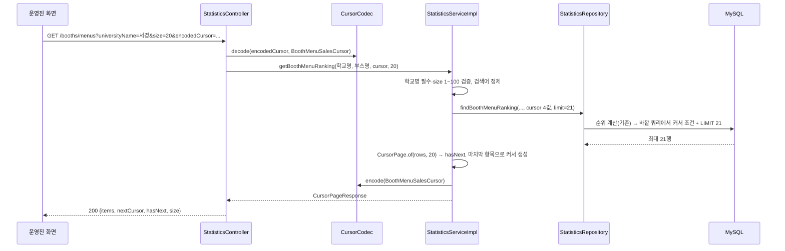

# LLD-0007: 부스 통계 검색 접두 일치 전환과 키셋 커서 페이지네이션

| 항목 | 내용 |
|---|---|
| 상태 | 확정 |
| 작성일 | 2026-11-10 |
| 작성자 | 코딩 에이전트 (Claude) |
| 관련 이슈 | [#20](https://github.com/silversieon/likelion14th-festival-be-V2/issues/20) |
| 관련 ADR | [ADR-0005](../adr/ADR-0005-statistics-search-prefix-match-and-keyset-cursor.md) — **옵션 1** (기존 집계 쿼리 구조 유지 + 접두 일치 + 키셋 커서), 2026-11-10 승인 |
| 대상 도메인 | statistics |
| 작업 갈래 | ③ 성능 개선 (AGENTS.md 1.4) |
| API 스펙 | [`docs/api-spec/statistics.md`](../api-spec/statistics.md) 0·5·6장 |

## 1. 개요 및 범위

운영진 통계의 **부스별 매출 검색**(`GET /api/statistics/booths/search`)과 **부스별 인기 메뉴 순위**(`GET /api/statistics/booths/menus`)를 다음과 같이 바꾼다.

1. 검색어 비교를 양쪽 와일드카드 `LIKE '%검색어%'`에서 **접두 일치 `LIKE '검색어%'`** 로 바꾼다.
2. 응답을 `List`에서 **`CursorPageResponse`** 로 바꾸고, 키셋 커서(마지막으로 본 행의 정렬 키보다 뒤에 있는 행을 `WHERE`로 바로 찾는 방식)로 `size`개씩 내려준다.

**범위 밖**: 나머지 통계 API 5종(총계·일별·시간대별·부스 TOP 10·메뉴 TOP 10), 집계 구조 변경(ADR-0005 옵션 2·3 — 채택되지 않음), 인덱스 추가.

### 현재 상태 (Before)

ADR-0005 "측정된 현상"의 요약이다 (5만 적재, Nginx `:8888`, 워밍업 5회 후 30회).

| API | 검색어 | 응답 행 | p50 | p95 |
|---|---|---|---|---|
| booths/search | 대학 | 14,009 | 367 ms | 776 ms |
| booths/search | 서경대학교 | 31 | 273 ms | 285 ms |
| booths/menus | 대학 | 140,022 (24.9 MB) | 3,179 ms | 3,627 ms |
| booths/menus | 서경대학교 | 242 | 243 ms | 255 ms |

- 학교명 `LIKE '%…%'`는 인덱스를 쓰지 못해, 부스 14,093행을 전부 조인한 뒤 한 행씩 비교한다.
- 완료 주문 전체 집계(order_items 101,138행)는 검색어와 상관없이 매번 돈다. **옵션 1은 이 비용을 그대로 둔다** (ADR-0005 확정 사항).

**기존 방식과의 차이**: 쿼리의 집계 구조는 그대로다. 바뀌는 것은 ① `LIKE` 패턴, ② 순위를 매긴 결과를 바깥 쿼리로 감싸 커서 조건 + `LIMIT`을 붙이는 것, ③ 응답 형태다.

## 2. 데이터 모델 (엔티티 / 테이블)

엔티티·테이블 변경 없음. 읽기만 한다: `universities`, `departments`, `booth`, `booth_menu`, `orders`, `order_items`.

### 2.3 비즈니스 규칙

| # | 규칙 |
|---|---|
| R1 | 학교명(`universityName`)은 필수다. 없거나 공백뿐이면 `STATISTICS_UNIVERSITY_NAME_REQUIRED`(400) — 기존 규칙 유지 |
| R2 | 검색어는 앞뒤 공백을 지우고 `!` → `!!`, `%` → `!%`, `_` → `!_` 순으로 이스케이프한다 — 기존 규칙 유지 |
| R3 | 학교명·부스명은 **접두 일치**다: `LIKE CONCAT(:keyword, '%') ESCAPE '!'`. 앞쪽 와일드카드는 붙이지 않는다 |
| R4 | `size`는 1 이상 100 이하다. 벗어나면 `STATISTICS_INVALID_PAGE_SIZE`(400). 기본값 20 |
| R5 | 매출 검색의 순위(`rank`)는 지금처럼 **전체 부스 기준**이고, 정렬은 `rank` 오름차순이다. 커서는 `lastRank` 하나다 (`ROW_NUMBER`라 유일) |
| R6 | 인기 메뉴의 순위는 지금처럼 **부스 안** 순위다. 정렬은 `(학교명, 학과명, 부스 id, 부스 안 순위)` 오름차순이고 커서는 이 네 값이다. 페이지 단위는 **메뉴 행**이다 |
| R7 | 다음 페이지가 있으면(`size + 1`번째 행이 있으면) `hasNext = true`이고, `nextCursor`는 **이번 페이지 마지막 항목**의 정렬 키를 `CursorCodec`으로 인코딩한 값이다. 없으면 `hasNext = false`, `nextCursor = null` |
| R8 | 응답 `size`는 이번 페이지 항목 수다 (주문 목록 API의 `OrderMapper.toCursorPageResponse`와 같은 의미). 빈 페이지면 0 |
| R9 | 커서를 해석할 수 없으면 `CursorCodec`이 `GlobalErrorCode.INVALID_INPUT_VALUE`(400)를 던진다 — 기존 공통 동작 |

**R6의 tie-breaker 근거**: 학교명은 지역이 다르면 같을 수 있다(`uq_universities_name_region`이 `(name, region)`). 학과명도 학교가 다르면 같을 수 있다. 따라서 `(학교명, 학과명)`만으로는 부스가 갈리지 않는다. `(부스 id, 부스 안 순위)`가 유일하므로 네 값 묶음이 전체 순서를 하나로 정한다 (policy 5.5).

## 3. 클래스 / 시그니처 정의

### 3.1 Controller — `StatisticsController`

```java
private final StatisticsService statisticsService;
private final CursorCodec cursorCodec;            // 추가

@GetMapping("/booths/search")
public ResponseEntity<BaseResponse<CursorPageResponse<BoothSalesResponse>>> searchBoothSales(
    @RequestParam(required = false) String universityName,
    @RequestParam(required = false) String boothName,
    @RequestParam(required = false) String encodedCursor,
    @RequestParam(defaultValue = "20") Integer size);
// BoothSalesCursor cursor = cursorCodec.decode(encodedCursor, BoothSalesCursor.class);

@GetMapping("/booths/menus")
public ResponseEntity<BaseResponse<CursorPageResponse<BoothMenuSalesResponse>>> getBoothMenuRanking(
    @RequestParam(required = false) String universityName,
    @RequestParam(required = false) String boothName,
    @RequestParam(required = false) String encodedCursor,
    @RequestParam(defaultValue = "20") Integer size);
// BoothMenuSalesCursor cursor = cursorCodec.decode(encodedCursor, BoothMenuSalesCursor.class);
```

- 응답 메시지(`"부스별 매출 검색에 성공했습니다."`, `"부스별 인기 메뉴 순위 조회에 성공했습니다."`)는 그대로 둔다. 메시지는 프런트가 구분에 쓰는 계약이다 (policy 14.2).
- Swagger `@Operation` 설명의 "부분 일치"를 "접두 일치"로 고치고 `encodedCursor`·`size`를 추가한다.

### 3.2 Service — `StatisticsService` / `StatisticsServiceImpl`

```java
CursorPageResponse<BoothSalesResponse> searchBoothSales(
    String universityName, String boothName, BoothSalesCursor cursor, int size);

CursorPageResponse<BoothMenuSalesResponse> getBoothMenuRanking(
    String universityName, String boothName, BoothMenuSalesCursor cursor, int size);
```

- `StatisticsServiceImpl`에 `CursorCodec`을 주입한다 (주문 도메인은 `OrderMapper`가 같은 역할을 한다. 통계 도메인은 매퍼 없이 서비스가 응답을 만들어 왔으므로 그 관례를 따른다).
- 처리 순서: 학교명 검증(R1) → `size` 검증(R4) → 검색어 정제(R2) → 리포지토리 호출(`limit = size + 1`) → `CursorPage.of(rows, size)` → 응답 변환 → 마지막 항목으로 커서 생성(R7).
- 상수: `MIN_PAGE_SIZE = 1`, `MAX_PAGE_SIZE = 100`.

### 3.3 Repository — `StatisticsRepository`

```java
List<BoothSalesRow> searchBoothSales(
    @Param("universityName") String universityName,
    @Param("boothName") String boothName,
    @Param("lastRank") Long lastRank,
    @Param("limit") int limit);

List<MenuSalesRow> findBoothMenuRanking(
    @Param("universityName") String universityName,
    @Param("boothName") String boothName,
    @Param("lastUniversityName") String lastUniversityName,
    @Param("lastDepartmentName") String lastDepartmentName,
    @Param("lastBoothId") Long lastBoothId,
    @Param("lastMenuRank") Long lastMenuRank,
    @Param("limit") int limit);
```

커서 인자가 모두 null이면 첫 페이지다. SQL은 8장.

### 3.5 DTO

`domain/statistics/dto/request/` (주문 도메인의 `*OrderCursor`와 같은 위치·형태):

```java
public record BoothSalesCursor(Long lastRank) {}

public record BoothMenuSalesCursor(
    String lastUniversityName, String lastDepartmentName, Long lastBoothId, Long lastMenuRank) {}
```

응답 DTO(`BoothSalesResponse`, `BoothMenuSalesResponse`)는 바꾸지 않는다. 바깥을 `CursorPageResponse<T>`가 감싼다.

`StatisticsErrorCode`에 추가:

```java
STATISTICS_INVALID_PAGE_SIZE(
    "STATISTICS_40004", "페이지 크기는 1 이상 100 이하로 입력해주세요.", HttpStatus.BAD_REQUEST);
```

## 4. 패키지 / 클래스 구조

```
domain/statistics/
├── controller/StatisticsController.java          (변경: 파라미터·응답 타입, CursorCodec 주입)
├── dto/request/BoothSalesCursor.java              (신규)
├── dto/request/BoothMenuSalesCursor.java          (신규)
├── exception/StatisticsErrorCode.java             (변경: STATISTICS_40004 추가)
├── repository/StatisticsRepository.java           (변경: 두 쿼리)
└── service/{StatisticsService, StatisticsServiceImpl}.java   (변경: 시그니처, 페이지 처리)

scripts/perf/statistics_search_bench.py            (신규: 13.4 측정 스크립트 — 도구성 코드)
```

## 5. 시퀀스 흐름



## 6. API 명세

[`docs/api-spec/statistics.md`](../api-spec/statistics.md) 0장(공통 규칙), 5장, 6장을 따른다. 상세는 중복하지 않는다.

## 7. 영속성 / 스키마 변경

해당 없음. 마이그레이션·ERD 변경 없음 (ADR-0005: 인덱스 추가 없음).

## 8. 인덱스 / 쿼리 설계

### 8.1 대상 쿼리

**매출 검색** — 기존 `RANKED_BOOTH_SALES`(전체 부스 순위 파생 테이블)를 그대로 쓰고 바깥 `WHERE`만 바꾼다.

```sql
-- RANKED_BOOTH_SALES (변경 없음)
WHERE ranked.universityName LIKE CONCAT(:universityName, '%') ESCAPE '!'
  AND (:boothName IS NULL OR ranked.departmentName LIKE CONCAT(:boothName, '%') ESCAPE '!')
  AND (:lastRank IS NULL OR ranked.salesRank > :lastRank)
ORDER BY ranked.salesRank
LIMIT :limit
```

**인기 메뉴** — 기존 쿼리에서 `ORDER BY`를 떼고 파생 테이블 `r`로 감싼다. 순위(`menuRank`)가 윈도 함수 결과라 같은 `SELECT` 안의 `WHERE`에서 쓸 수 없기 때문이다.

```sql
SELECT r.* FROM (
  -- 기존 SELECT ... ROW_NUMBER() OVER (PARTITION BY b.id ...) AS menuRank ... LEFT JOIN (MENU_SALES) s ...
  WHERE u.name LIKE CONCAT(:universityName, '%') ESCAPE '!'
    AND (:boothName IS NULL OR d.name LIKE CONCAT(:boothName, '%') ESCAPE '!')
) r
WHERE :lastBoothId IS NULL
   OR (r.universityName, r.departmentName, r.boothId, r.menuRank)
      > (:lastUniversityName, :lastDepartmentName, :lastBoothId, :lastMenuRank)
ORDER BY r.universityName, r.departmentName, r.boothId, r.menuRank
LIMIT :limit
```

- 행 생성자 비교(`(a, b, c, d) > (?, ?, ?, ?)`: 앞 컬럼부터 차례로 비교해 처음 달라지는 컬럼에서 대소를 정하는 비교)는 `ORDER BY`와 같은 컬럼·같은 콜레이션(`utf8mb4_unicode_ci`)으로 비교하므로 정렬 순서와 커서 비교가 어긋나지 않는다.
- 학교명 조건은 순위 계산 **안쪽**에 그대로 둔다. 커서 조건만 바깥에 둔다 — 순위는 부스 단위로 매기므로(`PARTITION BY b.id`) 학교·학과 조건이 순위를 바꾸지 않는다.

### 8.2 실행 계획 비교 (DB 단독, `EXPLAIN ANALYZE`)

| 쿼리 | 검색어 | Before | 접두 일치 프로토타입 | 비고 |
|---|---|---|---|---|
| 인기 메뉴 | 서경대학교 | 188 ms — `booth` 14,093행 조인 후 학교명 필터 | 164 ms — `Covering index range scan on u using uq_universities_name_region` (0.03 ms) | 나머지는 완료 주문 전체 집계(약 160 ms) |
| 인기 메뉴 | 대학 → (접두) | 1,560 ms / 140,022행 | 0행 (`대학`으로 시작하는 학교 없음) | |
| 인기 메뉴 | 한 (접두 최악) | — | 396 ms / 13,450행 | 옵티마이저가 `booth_menu` 전체 스캔을 선택. 페이지네이션으로 응답은 `size`행으로 줄어든다 |
| 매출 검색 | 서경대학교 | 331 ms | 같은 수준 | 전체 부스 순위를 먼저 계산해야 하므로 학교명 조건이 집계 범위를 줄이지 못한다 (ADR-0005에서 감수) |

### 8.3 추가/변경할 인덱스

**없음.** 이름 접두 일치는 기존 UNIQUE 인덱스(`uq_universities_name_region`, `uq_departments_university_name`, `uq_booth_department`)로 range 스캔된다. 집계 쪽 인덱스는 옵션 1 범위 밖이다 (ADR-0005).

## 9. 데이터 생성 스펙

해당 없음 (ADR-0004로 적재된 1단계 데이터를 그대로 측정에 쓴다).

## 10. 캐싱 / Read Model

해당 없음.

## 11. 트랜잭션 / 동시성 / 멱등성

- 두 서비스 메서드는 지금처럼 `@Transactional(readOnly = true)`.
- 페이지 사이에 주문이 완료되면 매출 순위가 바뀔 수 있다. 키셋 커서는 "직전 페이지 마지막 순위 다음"을 읽으므로, 그 사이 순위가 바뀐 부스는 **한 번 빠지거나 두 번 나올 수 있다.** 통계 화면 특성상 감수한다 (스냅샷 일관성이 필요하면 별도 이슈).
- 인기 메뉴는 정렬 키가 이름·id 위주라 같은 부스 안의 순위만 바뀔 수 있다.

## 12. 예외 및 에러 정책

| 상황 | 예외 | HTTP | 로그 |
|---|---|---|---|
| 학교명 없음·공백 | `STATISTICS_UNIVERSITY_NAME_REQUIRED` | 400 | INFO (기존) |
| `size` < 1 또는 > 100 | `STATISTICS_INVALID_PAGE_SIZE` (신규) | 400 | INFO `[StatisticsService] 부스 통계 검색 실패 - 페이지 크기 범위 밖: {size}` |
| 커서 해석 실패 | `GlobalErrorCode.INVALID_INPUT_VALUE` (`CursorCodec`) | 400 | 기존 |

검증 순서는 학교명 → `size`다. 학교명이 없으면 `size` 검증 전에 실패한다.

## 13. 테스트 계획

### 13.1 단위 테스트 — `StatisticsServiceImplTest` (Mockito, TDD 사이클 대상)

`CursorCodec`을 `@Mock`으로 추가한다. 기존 `SearchBoothSales`·`GetBoothMenuRanking` 테스트는 새 시그니처(`cursor = null`, `size = 20`, 리포지토리 `limit = 21`)로 옮긴다.

| # | 대상 | 동작 |
|---|---|---|
| U1 | searchBoothSales | `size`가 0·101이면 `STATISTICS_INVALID_PAGE_SIZE`를 던지고 리포지토리를 호출하지 않는다 |
| U2 | searchBoothSales | 학교명이 공백이면 `size`가 범위 밖이어도 `STATISTICS_UNIVERSITY_NAME_REQUIRED`를 먼저 던진다 |
| U3 | searchBoothSales | 커서가 null이면 `lastRank = null`, `limit = size + 1`로 조회한다 (정제·이스케이프 규칙은 기존 테스트 유지) |
| U4 | searchBoothSales | 커서가 있으면 `cursor.lastRank()`를 넘긴다 |
| U5 | searchBoothSales | 리포지토리가 `size + 1`행을 주면 `items`는 `size`개, `hasNext = true`, `nextCursor = encode(new BoothSalesCursor(마지막 항목 rank))` |
| U6 | searchBoothSales | `size`행 이하면 `hasNext = false`, `nextCursor = null`, `encode`를 호출하지 않는다 |
| U7 | getBoothMenuRanking | `size` 범위 밖이면 `STATISTICS_INVALID_PAGE_SIZE` |
| U8 | getBoothMenuRanking | 커서가 null이면 커서 인자 네 개를 모두 null로, 있으면 네 값을 그대로 넘기고 `limit = size + 1` |
| U9 | getBoothMenuRanking | `size + 1`행이면 `nextCursor = encode(new BoothMenuSalesCursor(마지막 항목의 학교명, 학과명, 부스 id, rank))`, `hasNext = true` |
| U10 | getBoothMenuRanking | 빈 결과면 `items` 빈 배열, `hasNext = false`, `nextCursor = null`, `size = 0` |

### 13.2 통합 테스트 — `StatisticsApiIntegrationTest` (Testcontainers MySQL, MockMvc)

기존 테스트의 `$.data[...]` 경로를 `$.data.items[...]`로 옮긴다. 각 테스트는 지금처럼 고유한 학교명으로 데이터를 만든다.

| # | 동작 |
|---|---|
| I1 | **접두 일치**: `통계접두대학교`를 만들고 `universityName=접두`(중간 문자열)로 두 API를 부르면 `items`가 비고, `universityName=통계접두`면 나온다. 부스명도 같다 (`boothName`에 학과명 중간 문자열 → 0건) |
| I2 | **매출 검색 페이지 넘김**: 한 학교에 부스 3개(매출이 서로 다름)를 만들고 `size=2`로 부르면 2건 + `hasNext = true`, `nextCursor`로 다시 부르면 나머지 1건 + `hasNext = false`. 두 페이지를 이으면 `rank` 오름차순이고 중복·누락이 없다 |
| I3 | **인기 메뉴 페이지 넘김 — 동명 학교**: 이름이 같고 지역이 다른 학교 2개에 같은 학과명 부스를 하나씩 만들고(메뉴 각 2개), `size=3`으로 끝까지 넘기면 메뉴 4건이 `(학교명, 학과명, boothId, rank)` 순서로 정확히 한 번씩 나온다 |
| I4 | `size=0`, `size=101`이면 400, 메시지 `페이지 크기는 1 이상 100 이하로 입력해주세요.` |
| I5 | `encodedCursor=not-a-cursor`면 400 |

### 13.3 분산 환경 검증

policy 17.2 대상(SSE·이벤트·스케줄러·멱등성·Redis·스키마)에 해당하지 않는다. 다만 성능 측정(13.4)은 policy 18.3에 따라 3인스턴스 + Nginx(`:8888`)에서 한다.

### 13.4 성능 측정

- **스크립트**: `scripts/perf/statistics_search_bench.py` — 표준 라이브러리만 쓰는 Python. ADMIN Access Token을 인자로 받아 Nginx `:8888`로 순차 호출한다.
- **조건**: Before와 같다 — 5만 적재 데이터, 앱 3대 + Nginx, 단일 클라이언트 순차 호출, 케이스별 워밍업 5회 후 30회, p50/p95/p99.
- **케이스**: Before 4개(`대학`, `서경대학교` × 두 API) + 접두 일치의 넓은 검색어 `한`(두 API, 첫 페이지와 두 번째 페이지). 기본 `size` 20.
- **결과 기록**: ADR-0005 "개선 실측치" 표.
- **판정**: 인기 메뉴 `대학`의 응답 행 수가 `size` 이하로 떨어지고, p95가 Before(3,627 ms)보다 줄었는지. 집계 비용(약 160~330 ms)은 남는 것이 예상 결과다 — 남은 비용은 ADR-0005 후속 작업으로 기록한다.

## 14. 미해결 질문 (Open Questions)

- ~~`size` 상한~~ — 개발자 별도 답이 없어 1~100, 기본 20으로 정했다 (주문 목록 API 기본값 20 관례 + 상한 없을 때 `size=100000`으로 Before와 같은 대량 응답이 가능해지는 것을 막기 위함). 바꾸려면 `MAX_PAGE_SIZE` 상수와 API 스펙만 고친다.
- 접두 일치 전환의 프런트 합의 — 사용자 요구사항 원문("와일드카드 기준을 우측으로")을 근거로 진행. 프런트 반영은 PR에 명시한다.
